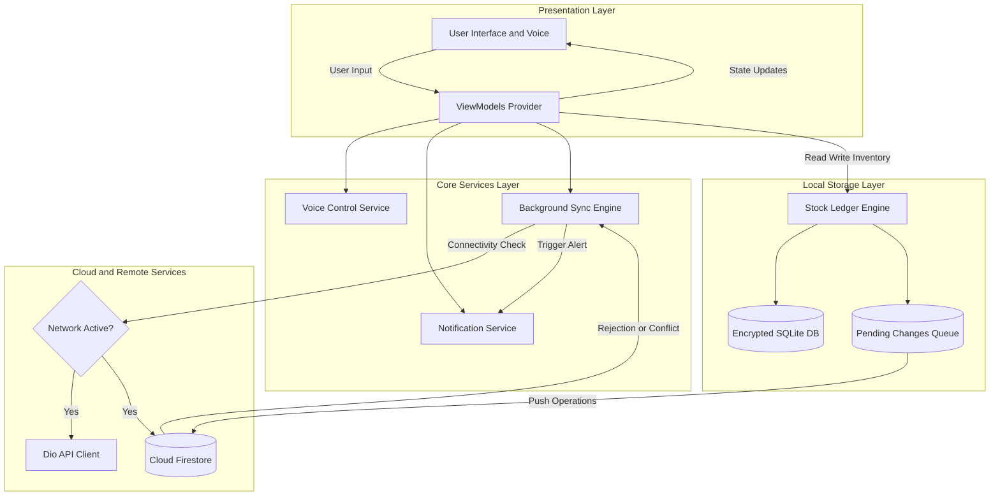

<div align="center">
  
  # 📦 SmartStore Lite
  
  [](https://git.io/typing-svg)

  
  
  
  

</div>

---

## 📖 Project Overview

**SmartStore Lite** is a robust, offline-first mobile application designed for seamless inventory and warehouse management. Built to handle environments with unstable internet connections, it relies on a secure local SQLite database as its single source of truth, synchronizing with Firebase Cloud services in the background whenever a connection is available.

Rather than simply overwriting stock numbers, SmartStore Lite utilizes a **Ledger-Based Architecture**. Every stock change (IN, OUT, TRANSFER, ADJUSTMENT) is recorded as an immutable transaction. The current stock is dynamically calculated using a ledger formula (`SUM(IN) - SUM(OUT)`), ensuring perfect audit trails and preventing data corruption.

### ✨ Core Features & Requirements Fulfilled

| Feature | Description |
| :--- | :--- |
| 🎨 **Material 3 & Responsive** | Full dynamic theming (Light/Dark mode) with fluid typography. On tablets (landscape), the UI smoothly transitions into a dual-pane **Master-Detail view**. |
| 🌐 **Smart Network & API** | Uses **Dio** with 4 custom interceptors (Logging, Auth, Cache, Error). Includes automatic Open Food Facts API integration via EAN-13 barcode lookup. |
| 🗄️ **Secure Local Ledger** | Uses **sqflite** combined with SQLCipher for encrypted local storage. Implements strict ACID atomic transactions for all stock movements. |
| ☁️ **Cloud Sync & Auth** | Secure **Firebase Authentication**. An offline queue stores pending changes and automatically syncs to Firestore upon network restoration. |
| 🎙️ **Voice & Notifications** | Natural Language Processing! Ask *"How many Nutella in the warehouse?"* and the app will respond using **Text-to-Speech (TTS)**. Local notifications alert you immediately when stock drops below thresholds. |

---

## 🏗️ Architecture Highlight
**SmartStore Lite** is built upon an **Offline-First MVVM (Model-View-ViewModel)** architectural pattern. It guarantees zero data loss during network disconnections by routing all writes through a secure local ledger before synchronizing with **cloud Firestore**.



---

## 🚀 Getting Started

Follow these instructions to get a copy of the project up and running on your local machine for development and testing.

### Prerequisites

*   [Flutter SDK](https://docs.flutter.dev/get-started/install) (Version 3.10.0 or higher)
*   Android Studio / VS Code
*   An Android Emulator or physical device

### 1. Clone the Repository

Open your terminal and run the following command to clone the project:

```bash
git clone https://github.com/your-username/smartstore-lite.git
cd smartstore-lite
```

### 2. Install Dependencies

Fetch all the required Flutter packages:

```bash
flutter clean
flutter pub get
```

### 3. Run the App

Launch the application on your connected device or emulator:

```bash
flutter run
```

*Note: If you are building for a final release APK, use `flutter build apk --release`.*

---

## 🧪 Testing

SmartStore Lite includes automated test scripts to ensure data integrity and layout stability. To run the full test suite (Models, Database calculations, and UI smoke tests):

**Using the provided script (Windows):**
```powershell
.\run_tests.ps1
```

**Using standard Flutter commands:**
```bash
flutter test
```

---

<div align="center">
  <i>Developed with ❤️ using Flutter.</i>
</div>
